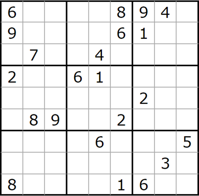

# sudoku-cpp



Sudoku solving and generating with c++

## Building

Since the code is only a handful of header files, there are no project files.
Directly build it with g++:

```sh
g++ -std=c++20 -O2 src/Solve.cpp    -o solve
g++ -std=c++20 -O2 src/Generate.cpp -o generate
```

This is what [`.github/workflows/build.yml`](.github/workflows/build.yml)
runs on every push and pull request. It also cross-compiles `solve.exe`/
`generate.exe` for Windows with MinGW-w64, uploaded as a `windows-binaries`
artifact on each run (see the Actions tab on GitHub) — no CMake/MSVC
project needed, since the code is plain, portable C++20.

### Releases

[`.github/workflows/release.yml`](.github/workflows/release.yml) runs when
a GitHub release is published: it builds `solve`/`generate` for both Linux
and Windows (cross-compiled with MinGW-w64) and attaches
`sudoku-cpp-<tag>-linux-x86_64.tar.gz`/`sudoku-cpp-<tag>-windows-x86_64.zip`
to the release as downloadable assets.

To cut a release (with the GitHub CLI):

```sh
gh release create v0.1.0 --repo chbauman/sudoku-cpp --title v0.1.0 --generate-notes --target main
```

### API docs

[`Doxyfile`](Doxyfile) is set up to document `src/`. With
[Doxygen](https://www.doxygen.nl/) installed, run from the repo root:

```sh
doxygen Doxyfile
```

This generates browsable HTML docs under `docs/html/index.html`.

## Usage

Two command-line tools are built from `src/`: `solve` and `generate`. Both
default to a standard 9x9 board (3x3 squares) and accept
`--square-height`/`--square-width` to work with other board sizes — see
[Board sizes](#board-sizes) below.

### `solve`

```sh
./solve "6 0 0 0 0 8 9 4 0  9 0 0 0 0 6 1 0 0  0 7 0 0 4 0 0 0 0  2 0 0 6 1 0 0 0 0  0 0 0 0 0 0 2 0 0  0 8 9 0 0 2 0 0 0  0 0 0 0 6 0 0 0 5  0 0 0 0 0 0 0 3 0  8 0 0 0 0 1 6 0 0"
```

Takes a puzzle in [row format](#input--output-format) as its one positional
argument. By default, solves it and reports whether the solution is unique
(stopping as soon as that's known, without enumerating every solution if
there are many), printing the solution if at least one exists. Exit code
is `0` if solved, `1` if invalid/unsolvable, `2` on a usage error.

```
$ ./solve --help
Usage: ./solve [--square-height H] [--square-width W] [--first-only | --count-all] "<puzzle>"

  <puzzle>          Row-major, space-separated cell values, 0 = empty.
                    Length must be (H*W)^2, e.g. 81 for the default 9x9 board.
  --square-height   Block height (default 3).
  --square-width    Block width (default 3).
  --first-only      Stop at the first solution found, without checking
                    whether it's the only one. Rarely needed: the default
                    already checks uniqueness at the same speed, but this
                    can be faster on puzzles where a second solution
                    exists but is hard to find.
  --count-all       Count every solution exactly. Can be far slower than
                    the default on underconstrained puzzles (many
                    solutions); use when you need the exact count rather
                    than just "unique" vs "multiple".
```

### `generate`

```sh
./generate
```

Generates sudoku puzzles, rates each by solving difficulty (guessing depth
needed, see [Difficulty level](#difficulty-level)), and saves them to `./Data/<square_height>x<square_width>/dat.txt`
by default (override with `--output-path`). This can run for a long time —
interrupt it with `Ctrl+C` once you have enough.
Every run uses a new random seed (printed at the start; pass `--seed` to repeat
a run). Puzzles that are already in the collection are skipped, with a warning
each time one is found (and a summary at the end), and puzzles that occur twice in the loaded file are only kept once
(`--fix-duplicates` removes them from the file).
The collection is saved every 200 iterations and again when `generate` is done,
which then prints how many puzzles there are per level (in total and added in
this run).

```
$ ./generate --help
Usage: ./generate [--square-height H] [--square-width W] [--max-per-level N] [--min-level L] [--max-level L] [--iterations N] [--climb-steps N] [--seed S]
                  [--output-path PATH] [--fix-duplicates]

  --square-height   Block height (default 3).
  --square-width    Block width (default 3).
  --max-per-level   Stop collecting puzzles for a difficulty level once the
                    collection has this many for it, including the ones loaded
                    from the output file (default 1000).
  --min-level       Minimum difficulty level of the puzzles to keep (default 5).
  --max-level       Maximum difficulty level of the puzzles to keep (default: no limit).
                    Puzzles above it are not rated exactly, which makes generating
                    the easy levels much faster.
  --iterations      Number of distinct fully-solved grids to try
                    generating puzzles from before stopping (default 50000).
  --climb-steps     Moves of the local search that tries to make each puzzle
                    of level 3 or more harder by moving one clue (default 2000,
                    0 disables it).
  --seed            Seed of the random number generator (default: random,
                    it is printed at the start). The same seed generates the
                    same puzzles, so use a different one for every run that
                    adds to the same file.
  --fix-duplicates  Only remove puzzles that occur more than once from the output
                    file (the first occurrence is kept) and exit.
  --output-path     File to load existing puzzles from and save to
                    (default ./Data/<square_height>x<square_width>/dat.txt).
                    Parent directories are created if missing.
```

### Difficulty level

Level `0` is the easiest: the puzzle can be solved completely with the two
simplest rules only (`solvable_by_easiest_rules`): a number that fits in only
one cell of a square, and the last empty cell of a row or column. Candidates are
eliminated directly by the numbers that are already set in the row, column and
square of a cell, without any of the other deductions.

Level `1` can be solved with the basic rules only (`solvable_by_basic_rules`):
the rules of level 0 and in addition a cell with only one candidate left, and a
number that fits in only one cell of a row or column (instead of only a square).

Otherwise, the level is two more than the nesting depth of guesses that is needed
(`solve_min_rec_depth`):
after all deductions, a cell is guessed, and every one of its candidates has
to be settled (either solved or refuted, which may itself need further
guesses). The level is the depth of this search tree for the best choice of
the guessed cell, among the cells with the fewest candidates. Level `2` means
that no guess is needed, but the basic rules are not enough (`rate_difficulty`
gives the level). `generate` keeps puzzles of level 5 or more by default, use
`--min-level 0` to collect the easiest ones too (with `--max-level 1` this is
fast).

`generate` removes random digits from a solved grid and then tries to remove
all remaining digits in random order, as long as the solution stays unique.
A digit that cannot be removed at some point never can be later, so one pass
ends in a *minimal* puzzle (no digit can be removed any more). Only minimal
puzzles are collected.

Random clue removal almost never produces puzzles of level 5 or more, so
after finding a puzzle `generate` runs a local search (`--climb-steps`): it
moves one clue to another cell and keeps the change if the solution stays
unique and the level does not drop. The results are minimized again before
they are collected.

### Generated puzzle file format

`generate` saves puzzles under `./Data/<square_height>x<square_width>/dat.txt`
— one line per puzzle, with 3 `;`-separated sections:

```
<descriptor>;<puzzle>;<solution>
```

The puzzle and solution sections are each in exactly the same
space-separated [row format](#input--output-format) `solve` takes on its
command line — so either can be copied straight out of this file and
pasted into `solve "..."` with no conversion. For example, this line was
written by actually saving the puzzle from the [`solve` example](#solve)
above together with its solution:

```
2,22,5,3,3,3,3,2,1,1,1;6 0 0 0 0 8 9 4 0 9 0 0 0 0 6 1 0 0 0 7 0 0 4 0 0 0 0 2 0 0 6 1 0 0 0 0 0 0 0 0 0 0 2 0 0 0 8 9 0 0 2 0 0 0 0 0 0 0 6 0 0 0 5 0 0 0 0 0 0 0 3 0 8 0 0 0 0 1 6 0 0;6 2 5 1 7 8 9 4 3 9 4 8 3 2 6 1 5 7 3 7 1 9 4 5 8 6 2 2 5 7 6 1 9 3 8 4 4 6 3 5 8 7 2 9 1 1 8 9 4 3 2 5 7 6 7 9 2 8 6 3 4 1 5 5 1 6 2 9 4 7 3 8 8 3 4 7 5 1 6 2 9
```

The descriptor section is comma-separated metadata, not meant to be used
as puzzle input:
- `2` — difficulty level, see [Difficulty level](#difficulty-level).
- `22` — 22 cells were given in the puzzle.
- `5,3,3,3,3,2,1,1,1` — how many times each digit occurs among those 22
  given cells, one count per digit 1-9, sorted in decreasing order.

The descriptor is exactly the string `generate_sud_char()` produces, which
is also the string `add_to_coll()` uses as a bucketing key — so
`--max-per-level` really limits "puzzles with this exact level and
digit-frequency profile", not just "puzzles at this level".

`separate_by_level_and_save()` (a library function on `SudokuGenerator`,
not currently exposed by `generate`'s CLI) splits a loaded collection by
level into `./Data/<H>x<W>/ext_lvl_<N>.txt` files in the same format.

Both sections use delimiters (rather than fixed-width fields) so the
format still works for board sizes with more than 9 values per cell, like
4x4 squares (16x16 grid, two-digit cell values).

### `generated_dat.txt`

[`generated_dat.txt`](generated_dat.txt) is a collection of some generated sudokus
in the file format above: 2010 puzzles for each of the levels 0 to 6 and
the few very hard ones of levels 7 and 8.

### Board sizes

Board dimensions aren't limited to the standard 9x9: `--square-height`/
`--square-width` select the block size (e.g. `2 2` for a 4x4 board, `2 3` for
a 6x6 board). Both tools are built for a small fixed set of sizes, listed in
their own `--help`: `2x2, 2x3, 3x2, 3x3, 3x4, 4x3, 4x4`. An unsupported size
is rejected with an error.

### Input / output format

A puzzle is a `raw_sudoku_t<square_height, square_width>`: a flat, row-major
array of `(square_height*square_width)^2` cells, where `0` means "empty" and
other digits (up to `square_height*square_width`) are given numbers. For the
default 9x9 board:

```cpp
const raw_sudoku_t<3, 3> puzzle = {
    6,0,0,0,0,8,9,4,0,
    9,0,0,0,0,6,1,0,0,
    0,7,0,0,4,0,0,0,0,
    2,0,0,6,1,0,0,0,0,
    0,0,0,0,0,0,2,0,0,
    0,8,9,0,0,2,0,0,0,
    0,0,0,0,6,0,0,0,5,
    0,0,0,0,0,0,0,3,0,
    8,0,0,0,0,1,6,0,0
};
```

`print_raw_sudoku<3, 3>(std::cout, puzzle)` renders it as a bordered grid
grouped into 3x3 squares:

```
+-------+-------+-------+-
| 6 0 0 | 0 0 8 | 9 4 0 |
| 9 0 0 | 0 0 6 | 1 0 0 |
| 0 7 0 | 0 4 0 | 0 0 0 |
+-------+-------+-------+-
| 2 0 0 | 6 1 0 | 0 0 0 |
| 0 0 0 | 0 0 0 | 2 0 0 |
| 0 8 9 | 0 0 2 | 0 0 0 |
+-------+-------+-------+-
| 0 0 0 | 0 6 0 | 0 0 5 |
| 0 0 0 | 0 0 0 | 0 3 0 |
| 8 0 0 | 0 0 1 | 6 0 0 |
+-------+-------+-------+-
```

The `solve` CLI tool's row format is the same grid flattened into one line,
cells separated by whitespace.

Internally, solving works on a `sudoku_data_t<square_height, square_width>`:
one entry per cell plus one more per cell per digit, tracking whether that
digit is still possible (`2`), ruled out (`1`), or moot because the cell is
already set (the cell's own entry is non-zero).
`init_sudoku_with_raw`/`get_raw_sudoku` convert between the two
representations, and `auto_fill` populates the possibility entries from the
given digits.

### Using it as a library

The solving and generating logic lives in three headers you can include
directly in your own code. Every type and function is templated on
`<square_height, square_width>` so one binary can work with more than one
board size:

- `SudokuCore.h` — sudoku types (`raw_sudoku_t<H,W>`, `sudoku_data_t<H,W>`),
  constants (`SudokuDims<H,W>`), printing, and init/conversion helpers.
- `SudokuSolver.h` — `class SudokuSolver<H,W>`: deterministic solving
  techniques plus brute-force solvers (`solve_brute_force_all`,
  `solve_count_rec_depth`, ...).
- `SudokuGenerator.h` — `class SudokuGenerator<H,W>` and
  `RandomNumberPicker<H,W>`: puzzle generation and the on-disk puzzle
  collection format.
